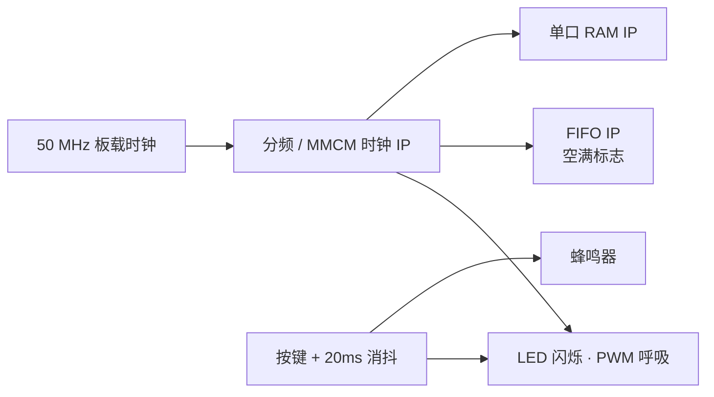

# ZYNQ FPGA 入门工程集

**每节课一个能上板的最小工程：点灯、按键、时钟、FIFO、RAM，一个一个过**

[快速开始](#3-快速开始与关键实现) · [常见问题](#4-常见问题) · [全部仓库索引](https://github.com/xhtfps/xhtfps)

## 为什么不用一个大工程

FPGA 入门最怕「一个大工程里塞所有外设」：综合一次三分钟，出问题不知道是约束、时序还是 IP 配置。这里反过来做——**一个知识点一个工程**，综合快、现象单一、失败原因唯一。

## 亮点

- **七个递进工程**：`led_twinkle` → `breath_led` → `key_led` → `key_beep` → 时钟 IP → FIFO IP → 单口 RAM。
- **计数公式写在正文**：`cnt_max = f_clk / (2*f_out)` 这类分频换算直接给结论，不用再推。
- **消抖有具体值**：20 ms 计数器，不是「加个延时」这种含糊说法。
- **产物不入库**：只交源码、约束与 IP 配置，`.bit` 与综合中间文件都在排除清单里。

## 结构

## 1. 目录一览

| 目录 | 内容 |
| --- | --- |
| `led_twinkle/` | 计数器分频闪烁灯（时序入门） |
| `breath_led/` | PWM 呼吸灯 |
| `key_led/` | 按键消抖 + 灯态切换 |
| `key_beep/` | 按键控制蜂鸣器 |
| `ip_clk_wiz/` | 时钟 IP（MMCM/PLL）产生多频时钟 |
| `ip_fifo/` | FIFO IP 读写与空满标志 |
| `ip_1port_ram/` | 单口 RAM IP 读写验证 |

## 2. 环境

| 项 | 要求 |
| --- | --- |
| 开发板 | 正点原子领航者 ZYNQ（XC7Z020） |
| 工具 | Vivado 2019.1 及以上（无 Vivado 无法综合） |
| 仿真 | Vivado Simulator（`sim_1` 一键跑） |
| 下载 | JTAG（板载下载器），下载 `.bit` 后观察现象 |

## 3. 快速开始与关键实现

1. 打开对应目录下的 `.xpr`，Vivado 自动加载工程。
2. `Run Synthesis` → `Run Implementation` → `Generate Bitstream`。
3. 打开 Hardware Manager，Program Device 下载 `.bit`，按工程说明操作按键观察现象。
4. 关键点：所有工程共用 50 MHz 板载时钟，改分频先算清计数值（`cnt_max = f_clk / (2*f_out)`）。
5. 按键必须消抖（20 ms 计数器），否则一次按下会触发多次状态切换。

## 4. 常见问题

- **综合报找不到 IP**：IP 目录（`*.xci`）未随仓库同步，先在 Vivado 里重新生成 IP。
- **下载后无现象**：确认约束文件里的引脚与板子原理图一致，特别是 LED/按键的 bank 电压。
- **时序不收敛**：小工程一般不会，若出现先检查未约束的跨时钟路径。
- **工程打不开提示版本不符**：Vivado 版本差异导致，用高版本打开后重新 Generate。

## 5. 维护说明

- 只交源码、约束与 IP 配置；综合产物与 `.bit` 不入库，见 [`EXCLUDED_FILES.md`](EXCLUDED_FILES.md)。
- 与 `zynq-navigator-board` 的分工：本仓库是自己写的 FPGA 工程，后者是厂商资料镜像（含 Vitis/Linux 教程）。
- 引用自正点原子教程的结构版权归原作者。

## 大文件去哪了

按 `SLIM-PLAN.md` 的口径做体积治理：以下文件**从 HEAD 移出、历史完整保留**。需要时按 `base_commit` 直链下载，不要重新提交进仓。

| 文件 | 体积 | 取回 |
| --- | --- | --- |
| `blk_mem_gen_v8_4_vhsyn_rfs.vhd` | 14.2 MB | [blob@92c34db](https://github.com/xhtfps/zynq-fpga-projects/blob/92c34dbcb140b1b26ecd2b6a0fa1f23dc087f35b/ip_fifo/ip_fifo.srcs/sources_1/ip/fifo_generator_0/hdl/blk_mem_gen_v8_4_vhsyn_rfs.vhd) |
| `blk_mem_gen_v8_3_vhsyn_rfs.vhd` | 14.2 MB | [blob@92c34db](https://github.com/xhtfps/zynq-fpga-projects/blob/92c34dbcb140b1b26ecd2b6a0fa1f23dc087f35b/led_twinkle/led_twinkle.srcs/sources_1/ip/ila_0/hdl/blk_mem_gen_v8_3_vhsyn_rfs.vhd) |

完整台账见 [`notes/offload.json`](https://github.com/xhtfps/notes/blob/main/offload.json)，恢复命令 `python tools/fetch-assets.py --repo zynq-fpga-projects`。

## 路线图

- [x] 七个入门工程逐个上板验证
- [x] 综合产物与 bitstream 移出，仓库只留可综合源码
- [ ] 补一个 `key_led` 的仿真 testbench，方便没板也能验证
- [ ] 增加 AXI GPIO / PS-PL 交互的最小例程

## 参与与反馈

- 遇到问题请走 [Issue 模板](.github/ISSUE_TEMPLATE)，注明 Vivado 版本与板卡版本。
- 提 PR 前先读 [CONTRIBUTING.md](CONTRIBUTING.md)；安全问题按 [SECURITY.md](SECURITY.md) 私下反馈。
- 如果这个仓库帮你省过时间，点个 ⭐ 是最省事的支持。

## 许可证

本仓自写源码见 [LICENSE](LICENSE)；Xilinx IP 与正点原子教程结构版权归各自作者，仅作学习参考。
